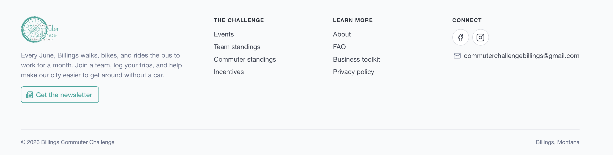

---

# {{ $frontmatter.title }}

It's been months since my last post and over a year since I wrote about Generative AI. We spent the summer renovating our kitchen and I insisted we do most of it ourselves. So, we spent most of our evenings and weekends on it.

I've been cooped up and sick most of the week and thought this would be a perfect time to give the Commuter Challenge a refresh. I'm also going to talk more about how my thoughts have changed about Generative AI, because a lot has changed since my first experiments with Gemini and Qwen.

## Introduction

While this is my first post in over a year on Generative AI, I have been using it at home and at work. The first experiences I wrote about last year were exciting, fun, and a bit frustrating. Though useful, it felt more like a fun toy than a tool I wanted to use daily. Then Claude Opus 4.5 came out, and things really started getting good. A lot of my previous complaints just no longer apply.

My goals today are to refresh the Commuter Challenge's UI and make it more pleasant to use. The UI sorely needed it and was pretty lackluster to begin with.

## Generative AI in the Last Year

Since those first early experiments, I've used it in other projects and started using it at work. One successful method is to define a new feature in a markdown file and iterate on it with Claude to record the requirements, edge cases, and so on. It even comes back and asks questions when it thinks something is ambiguous. You iterate until you think you have everything covered and tell Claude to implement it. Then you review the code and tests and merge. This is a pretty common loop you see with these tools. 

In one experiment, I created reusable instructions to migrate entire legacy RequireJS modules to Vue. To test them, I used two comparable and feature-rich pages. The first page was migrated manually and took almost two weeks to be converted, tested and deployed. Using these instructions, Claude migrated the second page on a git worktree while I did other tasks. The whole process took maybe six hours. Most of that was code review and verification. 

The goals today should be pretty easy in comparison.

## The Commuter Challenge

### The Setup

Today I used RubyMine, its built-in MCP server, Claude CLI, and Opus 5.5. 

### The Process

I kept it simple. I opened the project in RubyMine, started Claude, and iterated with it a few times to create a simple AGENTS.md. The main points were to use the existing [Bulma](https://bulma.io) CSS and to know about a few items in the stack like Pagy and Hotwire Turbo.

**Goals**
1. Learn how well Claude works in an established Rails project
2. Make the Commuter Challenge home page look nicer
3. Fix that hideous footer
4. Fix those ugly event and incentive cards
5. Tighten up the styling on all the forms and error reporting

I won't go into much detail on the process of updating the UI here. I wrote short prompts telling Claude the changes I wanted and iterated until it looked good enough. The cards and forms look much better now. I wanted to see what would happen if I simply told Claude the footer was ugly and to fix it. And that's how I got the most generic footer you see on every other website. It's not bad by any means; there's a reason so many websites use that format.

There were three things I wasn't expecting from a session that started as a styling update:

1. Claude found a few small bugs and suggested changes for them. One of the bugs was a form field that lacked date validation. Neat!
2. Claude decided that my tests were insufficient after it looked at my controllers (Claude was right). It wrote the tests it thought it needed without prompting. They were mostly good tests too.
3. Claude identified repeated markup and refactored it into partials without being asked.

## Conclusion

Today was a fun little coding session with Claude. We gave the Billings Commuter Challenge a much-needed refresh. While far from perfect, I'm happy with the improvements to the overall look of the website. It was a nice surprise to fix a few bugs too.

### The Good

- It looks much nicer.
- Claude noticed when tests were missing for the controllers and added them.
- It pointed out a couple of bugs where a user could get the Rails error page.
- No unexpected issues. Claude made the changes I asked and didn't write anything crazy.
- Layouts refactored into partials.

### The Bad

- The Commuter Challenge kind of looks like every other website you see these days. 
- It's not perfect. It still tried to recreate CSS rules and helper functions sometimes. But a good AGENTS.md file prevents most of it.
- It sometimes produces code I wouldn't want in production. But it's happening less and less and that's what we review for.
- I worry quite a bit about skill atrophy. How is a junior supposed to learn if they never write code? How can they learn to make good design decisions, perform good reviews, fix outages at 2 AM, or spot traps without the experience of writing code?

### What's Next?

For the next session, I would like to implement some new feature requests from the event organizers. These will require more backend changes and database migrations, and I'm interested to see how Claude handles Ruby on Rails.

---